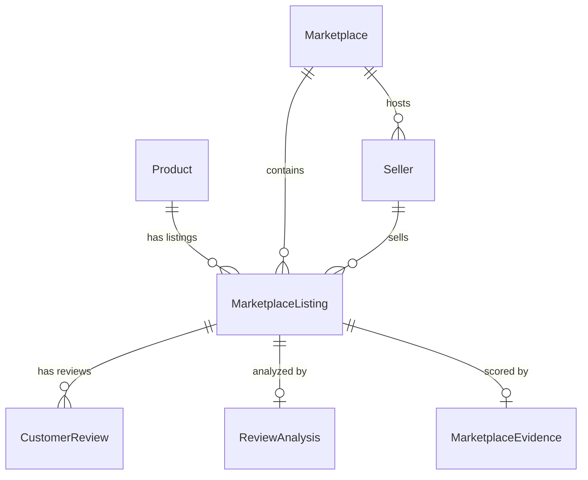

# Marketplace Integration & Persistence Architecture Design

## 1. Overview
This document specifies the database persistence flow for the **AI Cosmetic Product Verification System**. It maps multi-modal AI output (CLIP embeddings, OCR product detection, sentiment analysis, marketplace scraping results, and platform comparison evidence) to the PostgreSQL database schema defined in SQLAlchemy.

---

## 2. Entity Mapping & Data Flow



### Table Mappings:

| Pipeline Domain | Source Schema / Object | PostgreSQL Target Model | Unique Constraint / Lookup Strategy |
| :--- | :--- | :--- | :--- |
| **Catalog Product Identity** | `ProductIdentity` | `Product` | Lookup by `product_id` OR `(brand, product_name, shade_or_variant)` |
| **Marketplace Platform** | Platform Code (`amazon`, `daraz`, `temu`) | `Marketplace` | Lookup by `platform_code` |
| **Merchant / Seller** | `listing.seller_name` | `Seller` | Lookup by `(marketplace_id, seller_name)` |
| **Marketplace Listing** | `MarketplaceListing` | `MarketplaceListing` | Upsert by `(marketplace_id, product_url)` |
| **Scraped Customer Reviews** | `MarketplaceReview` | `CustomerReview` | Associated with `listing_id` |
| **Review Sentiment Analysis** | `ReviewResultDetails` | `ReviewAnalysis` | Unique index on `listing_id` |
| **Platform Comparison Evidence** | `PlatformComparisonScore` | `MarketplaceEvidence` | Unique index on `listing_id` |

---

## 3. Data Integrity & Authenticity Guardrails

### A. Non-Conflation of CLIP & Physical Authenticity
- **CLIP Similarity** represents visual embedding cosine similarity between the input product image and reference dataset catalog photos.
- **CLIP Similarity Score IS NOT PROOF OF AUTHENTICITY**.
- In database storage:
  - `MarketplaceListing.match_confidence` stores the text-and-visual match percentage against catalog metadata.
  - `ReviewAnalysis` stores sentiment and review authenticity signals.
  - Ensemble authenticity score is stored in analysis results separately.

### B. Blocked & Unavailable Source Safety
- When a marketplace source is blocked or unavailable (e.g. anti-bot captcha or 403 Forbidden):
  - `source_status` is recorded as `"blocked"` or `"unavailable"`.
  - `price`, `rating`, and `review_count` remain default (`0.0` or `None`).
  - `status_explanation` records the restriction rationale (e.g., `"Marketplace access restricted by anti-bot controls"`).
  - **Zero fabricated or synthetic data is stored.**

### C. Idempotency & Transaction Safety
- All operations execute within an explicit SQLAlchemy transaction block (`session.begin()`).
- In case of any database exception, `session.rollback()` is invoked immediately, ensuring zero partial or corrupted state.
- Existing records are retrieved using indexed lookups to prevent duplicate insertion.

---

## 4. Service Persistence Flow

```
[ POST /api/analyze ]
        │
        ├── 1. OCR Text Extraction & Image Inspection
        ├── 2. CLIP Similarity Search
        ├── 3. Construct Product Identity
        ├── 4. Marketplace Search (Amazon, Daraz, Temu)
        ├── 5. Compare & Score Platforms
        ├── 6. Analyze Review Authenticity
        │
        └── 7. Persist Analysis Results to PostgreSQL (database/persistence_service.py)
                ├── Get or Create Product
                ├── Get or Create Marketplaces (Amazon, Daraz, Temu)
                ├── Get or Create Sellers
                ├── Upsert Marketplace Listings
                ├── Insert Customer Reviews
                ├── Upsert Review Analysis
                └── Upsert Marketplace Evidence
```
